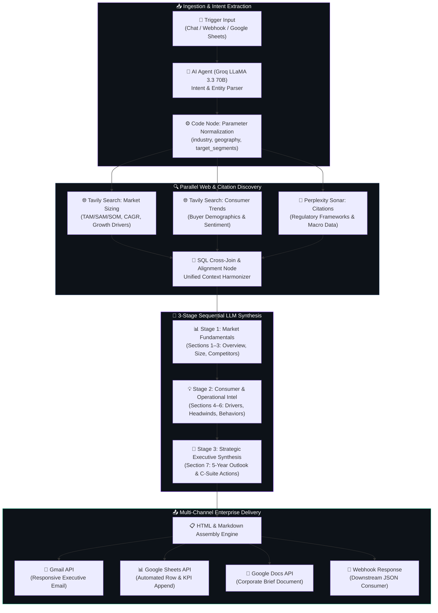

<div align="center">
  

  **Autonomous market intelligence engine orchestrated with n8n, Groq LLaMA 3.3 70B, Tavily Search, and Perplexity Sonar. Delivers structured C-suite research dossiers in <60 seconds.**

  <p align="center">
    <a href="https://github.com/RishabJainhub/market-research-pipeline"></a>
    <a href="https://github.com/RishabJainhub/market-research-pipeline"></a>
    <a href="https://github.com/RishabJainhub/market-research-pipeline"></a>
    <a href="https://github.com/RishabJainhub/market-research-pipeline"></a>
    <a href="https://github.com/RishabJainhub/market-research-pipeline"></a>
    <a href="./LICENSE"></a>
  </p>

  [🏗️ Architecture](#-system-architecture) · [🚀 Quick Start](#-quick-start--configuration) · [📊 Sample Reports](#-sample-intelligence-reports) · [🧠 Prompt Engineering](#-prompt-engineering--quality-gates) · [📚 Documentation](docs/)
</div>

---

## ⚡ Executive Summary & Quantified Impact

Traditional corporate market intelligence and commercial due diligence workflows require **4 to 12 hours of manual desk research** per industry query, involving fragmented Google searches, paid report paywalls, manual data collation, and slide drafting.

The **Autonomous Market Intelligence Pipeline** replaces manual workflows with a deterministic, multi-agent orchestration architecture executed via **n8n**:

- ⏱️ **Sub-60s Execution Turnaround:** Transforms raw natural-language queries (e.g., *"Electric two-wheelers in India"* or *"Embedded lending in the UK"*) into a formatted 7-section intelligence brief in **under 60 seconds**.
- 📉 **90% Reduction in Manual Effort:** Automates the complete discovery, validation, competitive benchmarking, and document formatting lifecycle.
- 🌐 **Multi-Source Real-Time Grounding:** Combines **Tavily Search API** (live web discovery & market sizing) with **Perplexity Sonar** (deep factual citation & macroeconomic validation).
- ⚡ **Ultra-Low Latency Inference:** Powered by **Groq LPU™ technology** hosting **Meta LLaMA 3.3 70B**, delivering over 250 tokens/sec for sequential prompt reasoning.
- 📑 **Automated Multi-Channel Distribution:** Dispatches responsive HTML executive dossiers via **Gmail API**, updates structured metric trackers in **Google Sheets**, compiles formatted briefing documents in **Google Docs**, and returns JSON payloads via webhooks.

---

## 🏛️ System Architecture



---

## 📋 Comprehensive 7-Section Dossier Specification

Every execution generates a standardized, boardroom-ready market research brief structured as follows:

| # | Section Name | Focus & Output Content |
|---|---|---|
| **1** | **Market Overview** | Industry taxonomy, regulatory perimeter, primary value chain, and core business models. |
| **2** | **Market Size & Projections** | Total Addressable Market (TAM), Serviceable Addressable Market (SAM), Serviceable Obtainable Market (SOM), 5-year CAGR, and confidence tiering. |
| **3** | **Competitive Landscape** | Market share breakdown table, top 5 incumbents/challengers, defensible moats, and critical vulnerabilities. |
| **4** | **Growth Catalysts** | Macroeconomic, technological, and demographic tailwinds driving adoption. |
| **5** | **Barriers & Strategic Risks** | Supply chain dependencies, margin pressures, policy headwinds, and execution risks. |
| **6** | **Consumer & Demand Dynamics** | Customer purchasing criteria, price sensitivity, demographic shifts, and willingness to pay. |
| **7** | **Strategic Outlook & Recommendations** | 3 actionable C-suite strategic mandates and risk-adjusted scenario planning. |

---

## 🧠 Prompt Engineering & Quality Gates

To prevent hallucination, factual drift, and narrative bloat, the pipeline implements an enterprise-grade prompt architecture:

1. **Context Isolation & Sequential Chaining:**
   - Instead of asking a single LLM to generate all 7 sections simultaneously (which causes degradation in later sections), the analysis is split into **three sequential stages**:
     - **Stage 1 (Fundamentals):** Grounded strictly in factual market sizing data.
     - **Stage 2 (Consumer Intelligence):** Consumes Stage 1 outputs to contextualize consumer shifts.
     - **Stage 3 (Synthesis):** Evaluates trade-offs and generates decisive strategic recommendations.
2. **Strict Guardrails & Zero-Fabrication Mandate:**
   - Prompts include explicit system constraints: *"You are an elite corporate strategy consultant. Cite exact figures from search context. Never fabricate market sizing statistics or market shares. Explicitly mark estimates as (Estimated)."*
3. **Deterministic Sampling:**
   - Set to `temperature: 0.3` to prioritize analytical precision over divergent creativity.
4. **Resilient Failure Recovery:**
   - All n8n HTTP Request nodes include `neverError: true` fallback flags, ensuring secondary search pathways maintain execution if any individual endpoint experiences transient throttling.

---

## 📊 Sample Intelligence Reports

<details>
<summary><b>📄 Sample 1: Electric Vehicles (EV) — India Ecosystem (Click to expand)</b></summary>

### 1. Market Overview
India's electric vehicle ecosystem is characterized by strong policy incentives (FAME II / PM E-DRIVE) and rapid electrification in two-wheelers (E2W) and three-wheelers (E3W), which represent >90% of total volume.

### 2. Market Sizing & CAGR
- **TAM:** \$7.1B (2025) → Projected \$114.0B by 2030 (CAGR: 66.5%)
- **SAM:** \$3.2B (High-density urban commuter two-wheelers)
- **SOM:** \$450M (Commercial fleet & delivery logistics)

### 3. Competitive Matrix
| Player | Market Share | Primary Moat | Key Vulnerability |
| :--- | :--- | :--- | :--- |
| **Tata Motors** | ~70% (Passenger Cars) | First-mover EV ecosystem & dealer reach | Limited sub-₹10L pure EV offerings |
| **Ola Electric** | ~35% (E2W) | In-house Gigafactory battery integration | Customer service backlog & margin burn |
| **TVS Motor** | ~18% (E2W) | High customer trust & legacy dealer scale | Slower battery R&D cycles |
| **Ather Energy** | ~12% (E2W) | Proprietary charging grid & premium software | Capital intensity & geographic expansion speed |

*... [Complete 7-section report available in `samples/electric-vehicles-india.md`]*

</details>

<details>
<summary><b>📄 Sample 2: SME B2B Fintech & Embedded Lending — United Kingdom (Click to expand)</b></summary>

### 1. Market Overview
The UK SME alternative finance sector bridges the credit deficit created by high-street banking consolidation, utilizing Open Banking APIs and real-time accounting integration (Xero/QuickBooks).

### 2. Market Sizing & CAGR
- **TAM:** £22.4B total annual SME gross lending originations
- **SAM:** £5.8B revenue-based financing and merchant cash advance (MCA)
- **SOM:** £850M tech-enabled fast-approval commercial loans (<£100k ticket)

### 3. Incumbents vs. Challengers
- **Funding Circle:** Market leader in government-backed commercial loan origination.
- **YouLend:** Embedded revenue-based financing integrated into checkout gateways (eBay, Shopify).
- **iwoca:** Automated credit decisioning engine approving lines of credit in under 5 minutes.

*... [Complete 7-section report available in `samples/fintech-uk.md`]*

</details>

---

## 🛠️ Technology Stack & Integrations

| Layer | Technologies & Services |
| :--- | :--- |
| **Workflow Engine** | n8n (Community / Self-Hosted / Cloud), Multi-Node Routing, Webhooks |
| **LLM Inference** | Groq LPU™ Cloud hosting Meta LLaMA 3.3 70B Versatile |
| **Web Discovery** | Tavily Search API (Deep Search, Filtered Domains, Raw Content Parsing) |
| **Deep Citations** | Perplexity Sonar API (Direct Academic & News Citations) |
| **Productivity Integrations** | Google Docs API, Google Sheets API, Gmail API |
| **Data Parsing** | JavaScript Code Nodes, SQL Data Manipulation, Markdown-to-HTML Parser |

---

## 📂 Repository Structure

```
market-research-pipeline/
├── README.md                     # Comprehensive technical documentation & showcase
├── ARCHITECTURE.md               # Node-by-node architectural deep-dive
├── workflow.json                 # Exported, production-ready n8n workflow (keys redacted)
├── repo_metadata.json            # Repository topics, description & metadata
├── LICENSE                       # MIT License
├── .env.example                  # Environment configuration template
├── docs/
│   ├── setup-guide.md            # Step-by-step installation & credentials guide
│   ├── api-reference.md          # Webhook API inputs and payload schemas
│   └── prompt-engineering.md     # 3-stage prompt design principles and guardrails
├── samples/
│   ├── electric-vehicles-india.md# Full generated intelligence dossier (India EV)
│   └── fintech-uk.md             # Full generated intelligence dossier (UK SME Fintech)
└── evaluation/
    └── evaluation-report.md      # Accuracy benchmarks, latency telemetry & audit metrics
```

---

## 🚀 Quick Start & Configuration

### Prerequisites
- Running [n8n](https://n8n.io) instance (v1.0+)
- [Groq API Key](https://console.groq.com)
- [Tavily API Key](https://tavily.com)
- *(Optional)* [Perplexity API Key](https://docs.perplexity.ai) & Google Workspace OAuth2

### 1. Clone the Repository
```bash
git clone https://github.com/RishabJainhub/market-research-pipeline.git
cd market-research-pipeline
```

### 2. Configure Environment Variables
```bash
cp .env.example .env
```
Fill in your API keys in `.env`:
```ini
TAVILY_API_KEY=tvly-your-api-key-here
GROQ_API_KEY=gsk_your-api-key-here
PERPLEXITY_API_KEY=pplx-your-api-key-here
```

### 3. Import Workflow into n8n
1. Open your n8n workspace.
2. Navigate to **Workflows** → Click **Add Workflow** → Select **Import from File**.
3. Choose `workflow.json` from this repository.
4. Set up your Groq, Tavily, and Gmail/Google credentials in n8n's credential manager.
5. Click **Activate Workflow**.

### 4. Trigger Execution via Webhook or Chat
Send a POST request to your n8n webhook endpoint:
```bash
curl -X POST https://your-n8n-instance.com/webhook/market-research \
  -H "Content-Type: application/json" \
  -d '{"query": "Artificial intelligence chipmakers in Europe", "email": "analyst@example.com"}'
```
Receive your structured 7-section intelligence brief in your inbox and webhook response in `<60 seconds`!

---

<div align="center">

### 👨‍💻 Author & Systems Architect

**Rishab P Jain**  
*AI Generalist & Workflow Automation Specialist*  

🎓 **MSc in Business with Consulting** — Warwick Business School (WBS), University of Warwick  
🎓 **BBA in Strategy & Business Analytics** (First Class with Distinction, CGPA 9.04/10) — Christ University  
💼 **Ex-HPE Business Operations** · Published Author (*IGI Global, 2026*)  

[](https://www.linkedin.com/in/rishab-p-jain/)
[](https://github.com/RishabJainhub)

---

⭐ **Star this repository if you find it valuable for agentic AI, workflow automation, or market intelligence.**

</div>
